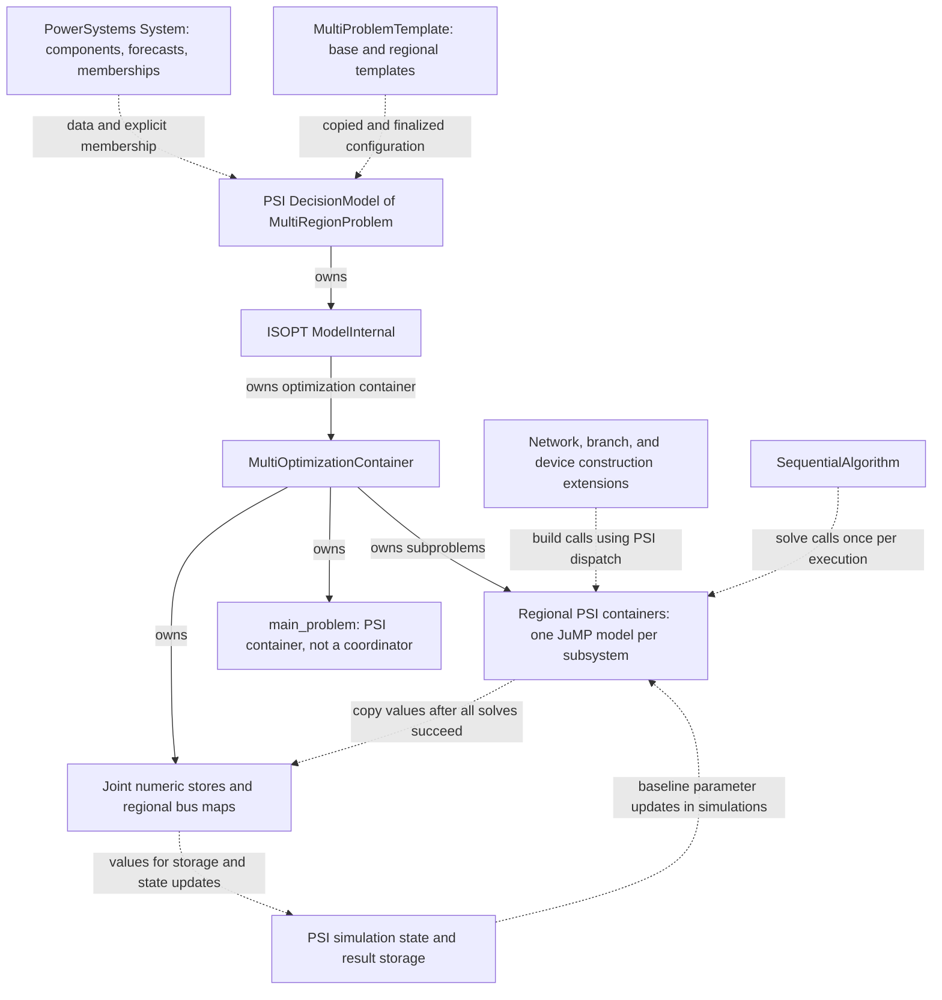

# Extension lifecycle

The package relies on Julia multiple dispatch to extend PSI and InfrastructureSystems
interfaces. It does not wrap PSI in an independent simulation framework.

## Architecture at a glance

Solid arrows show **ownership**; dashed arrows show labeled **calls or data
transfers**, not ownership. `PSI` denotes PowerSimulations and `ISOPT` denotes
InfrastructureSystems' optimization interfaces. Regional containers own the
actual optimization models. The main container and joint numeric stores do not
form a central coordinating optimization problem.

The state-update arrow applies only when PSI runs the model in a simulation.
It is not a regional convergence loop: each execution solves every region once,
then aggregates results. Initialization sets the input System to `SYSTEM_BASE`;
state-estimation injections and flows use that System's per-unit base.

Trace the ownership nodes to `multiproblem_template.jl`,
`multi_optimization_container.jl`, and `problems/multi_region_problem.jl`;
construction dispatch to `models/network_models.jl` and `models/branch_models.jl`;
and solve/copy calls to `algorithms/sequential_algorithm.jl`. The
[repository map](index.md) describes these files. For chronological execution
rather than ownership, see [Split-area modeling](../explanation/decomposition.md)
and the separate [state-passing sequences](../explanation/state_passing.md).

## Construction and ownership

 1. `MultiProblemTemplate` stores a base `PSI.ProblemTemplate` and a dictionary of
    deep-copied regional templates. PSI setters are specialized for this type.
    Do not assume all setter overloads have identical copying behavior:
    some set subsystem metadata on the supplied model before copying it.
 2. `PSI.DecisionModel{MultiRegionProblem}` builds PSI settings, auto-transforms
    time series, creates `ISOPT.ModelInternal`, and selects
    `MultiOptimizationContainer(SequentialAlgorithm, ...)`.
 3. Construction deep-copies/finalizes the template. Regional device/branch
    models without available components are removed; service contributors and
   device-service relationships and upstream device/service outage metadata
   are populated. Configure outage attachments and monitoring before construction.
 4. Time-series validation requires forecast data. The container constructor
    independently rejects multiple resolutions and abstract time-series types.

`MultiOptimizationContainer` owns a `main_problem` PSI container, regional PSI
containers, a regional bus map, and joint stores keyed by IS optimization keys.
Its main JuMP model is not a central optimization model that coordinates the
regional solves. Shared result arrays contain numeric values rather than a
single combined regional JuMP problem.

## Build

`PSI.build_impl!(model)` performs:

 1. `build_pre_step!`: initialize settings/time axes, set the System to
    `SYSTEM_BASE`, initialize each regional PSI container, initialize store
    parameters, and set build status to `IN_PROGRESS`.
 2. `instantiate_network_model`: set each regional subsystem, intersect branch
    filter functions with membership, and instantiate PSI network data.
 3. `handle_initial_conditions!`: currently **empty** for this model.
 4. `PSI.build_model!`: dispatch into sequential `build_impl!`, which calls PSI's
    regional build, constructs bus maps, checks static-injector and modeled-HVDC
    membership, and checks containers.
 5. `_map_containers`: union dense result axes, allocate joint numeric arrays,
    preserve sparse tuple-key unions through `_map_sparse_containers!`, and merge
    parameter arrays/multipliers/attributes.
 6. Mark the multi-container for recurrent solves and log settings.

Sparse stores use actual regional keys rather than Cartesian products of axes.
Mixed dense/sparse representations for the same result key raise an error.
Parameter attributes must agree;
time-series attribute maps reject collisions. Compatible axes and nonoverlapping
result ownership are assumptions, not an arbitrary concatenation facility.

## Solve and result storage

`PSI.solve_impl!(model)` calls the internal algorithm's `solve_impl!`. The
sequential method iterates regional containers, calls `PSI.solve_impl!` on each,
and returns early when a region does not finalize successfully. Only after all
regions succeed does it copy values to the joint stores.

The model records run status and raises/logs failure according to PSI's
`allow_fails` setting. PSI's outer `solve!`/simulation machinery writes results
and optimizer statistics. The package does not explicitly aggregate regional
objective values or create a convergence certificate.

Dense field copying treats one-, two-, and three-dimensional arrays separately.
Sparse field copying evaluates each existing tuple-keyed entry with PSI's value
accessor. This supports contingency-flow exports without adding missing pairs.
AC-bus active-power balances copy only assigned regional buses.
Parameters/multipliers have a separate one-/two-dimensional path.
Read [result limitations](../how_to/results.md) before adding a new store shape.

## Simulation updates

PSI owns `SimulationModels`, `SimulationSequence`, simulation clocks, stores,
and decision/system state. This package extends:

  - `PSI._add_feedforward_to_model`: attach device feedforwards across regional
    templates; attach service feedforwards using component type and optional
    service-name metadata.
  - `PSI.update_model!`: delegate to PSI's state/chronology update interface.
  - `PSI.update_parameters!`: mark each region's objective unsynchronized,
    update its parameter keys, then refresh objectives when required.
  - `PSI.update_container_parameter_values!`: special-case baseline injections/
    monitored-line flows; delegate other keys to PSI decision-state handling.
  - `PSI.update_system_state!` for AC-bus active-power-balance expressions:
    reject past updates, skip repeated timestamps, and write a one-row system
    dataset with coordinated timestamps.

These state methods are not an ad hoc DataFrame feedforward. Preserve component
keys, source entry types, metadata, timestamps, units, and model chronology.
See the separate sequence diagrams in [State passing](../explanation/state_passing.md).

## Add or extend a formulation

 1. Identify the owning PSI abstract formulation/entry type and the actual
    compatible dispatch signature. Inspect the installed source with
    `pkgdir(PowerSimulations)`, not only current online docs.
 2. Reuse existing template setters and subsystem-aware component iterators.
    Keep argument-stage variable/parameter creation separate from model-stage
    constraints, expressions, and objective terms.
 3. Implement source-linked methods under `src/models/`; define new keys or
    formulations under `src/core/` and include before consumers.
 4. Preserve units, mapped bus axes, branch direction, service metadata, and
    feedforward identity. Register result/dual entries through PSI interfaces.
 5. Test the smallest public build/solve behavior, plus physical invariants and
    errors. Select [related regression files](workflow.md) for each affected
    surface.
 6. Check result aggregation for the exact dimensionality and sparse/dense
    representation. A working regional model does not prove joint storage works.
 7. Update the formulation library and API docstrings without claiming support
    beyond evidence.

## Scaffolding is not functionality

`MPIParallelAlgorithm` is included but its method references unresolved
`sp`, `params`, `method`, and other incomplete work. Public construction does
not select it. `multi_decision_model.jl` is empty/unincluded, while
`core/auxiliary_variables.jl` is an empty included scaffold.
Optimization-model serialization and numerical-bound-check overrides are
no-ops, as is the package's initial-condition build hook. Do not describe these
as completed implementations.
