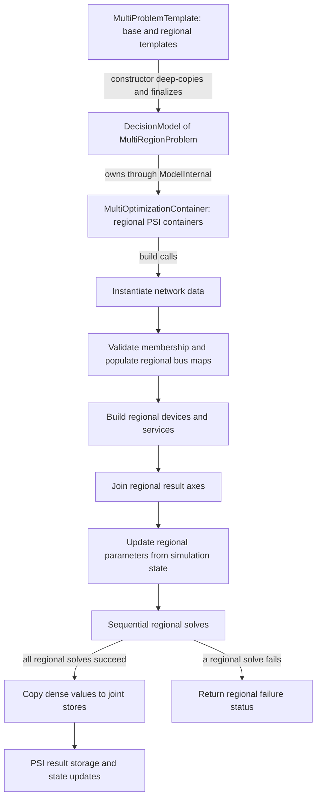

# Split-area modeling

The package decomposes **model construction and execution**, not System data
ownership. One System provides topology and forecasts, named subsystems select
regional components, and a `MultiProblemTemplate` produces regional PSI models.

## Regional decisions and network context

`SplitAreaPTDFPowerModel` uses area-level balances for the areas selected by a
regional network model. Local static-injection decisions contribute to both
their area balance and nodal power-balance expressions. Network PTDF expressions
retain the full bus context needed for line-flow calculations.

`StateEstimationInjections` supplies other subsystems' bus injections as
parameters in nodal expressions. These are not extra local generation decisions
and do not create an iterative exchange between regional solves.
Optional `AreaInterchange` decisions enter the from-area balance with coefficient
`-1` and the to-area balance with coefficient `+1`.

The [formulation library](../formulation_library/network.md) gives the equations
and baseline-flow correction. `StaticBranchUnboundedStateEstimation` is the
special monitored-line formulation; it is not an estimator that infers state
from noisy measurements.

## HVDC area balances and dependency compatibility

An HVDC can connect two different areas while remaining internal to one
subsystem. The HVDC, both terminal buses, and both terminal areas must be
assigned to that subsystem. See the [assignment cases](../how_to/subsystems.md#Allowed-and-rejected-HVDC-assignments)
for allowed and rejected configurations.

For the tested `TwoTerminalGenericHVDCLine` with `HVDCTwoTerminalLossless`, a
positive flow contributes `-flow` at the starting bus and `+flow` at the ending
bus, with the same signs in the respective area balances. If both buses share
an area, those area contributions cancel; the nodal contributions still affect
the PTDF network expressions.

PowerSimulations 0.38.5 includes
[Sienna-Platform/PowerSimulations.jl#1681](https://github.com/Sienna-Platform/PowerSimulations.jl/pull/1681),
which extends the lossless HVDC expression method from `PTDFPowerModel` to
`AbstractPTDFModel` and includes the appropriate area-balance contributions.
`SplitAreaPTDFPowerModel` belongs to that broader model family.

The previous build-only fixture moved an endpoint bus into subsystem `a` while
leaving its area outside `a`. Before the upgrade, this fixture did not enter the
new area-aware expression path. With the upgrade, constructing its missing area
balance contribution exposed `KeyError: key "3" not found`. A previously passing
build assertion was not evidence that the HVDC's area contributions were correct.

The local validation now reports `ConflictingInputsError` before constructing
regional variables when terminal-area membership is inconsistent. This is an
explicitly stricter input check, not a change to the upstream HVDC equations.
The regression fixtures cover both a consistent same-area assignment and a
consistent different-area assignment. Other network formulations bypass this
additional area check; the existing HVDC terminal-bus check still applies.

## Construction and execution

Arrows describe construction calls and execution/data flow; they do not imply a
central optimization solve. A standalone solve does not require the
simulation-state update step. In a simulation, PSI repeats the update/solve/
storage portion according to the sequence and intervals.

The sequential implementation solves every regional container once per model
execution and returns early on failure. It does not update a later region from
an earlier region's freshly solved values inside that loop. Region iteration
follows dictionary iteration, not the sorted template-key accessor's order.
There is no residual criterion, iteration count, or convergence proof in this
path.

## Assumptions and limitations

  - Membership and boundary ownership are study inputs; the package does not
    optimize or automatically choose them.
  - Modeled static injections and their buses must be co-assigned. Modeled
    two-terminal HVDC terminal buses must be in the HVDC's subsystem. With
    `SplitAreaPTDFPowerModel`, their areas must also be assigned there; the
    terminal areas do not have to be equal.
  - Initialization changes the input System's unit setting to `SYSTEM_BASE`.
    Internal injections and flows are system-base per-unit quantities; preserve
    the System base and original branch direction when interpreting them.
  - A single time-series resolution is required by the multi-container constructor.
    Specifying `resolution` does not bypass that constructor restriction.
  - The [result aggregation limits](../how_to/results.md) matter for shared
    components and sparse outputs.
  - MPI (Message Passing Interface) execution is incomplete; no sequential/MPI
    equivalence is established.

These contracts are implemented by `multiproblem_template.jl`,
`multi_optimization_container.jl`, `problems/multi_region_problem.jl`,
`algorithms/sequential_algorithm.jl`, and `models/network_models.jl`.
