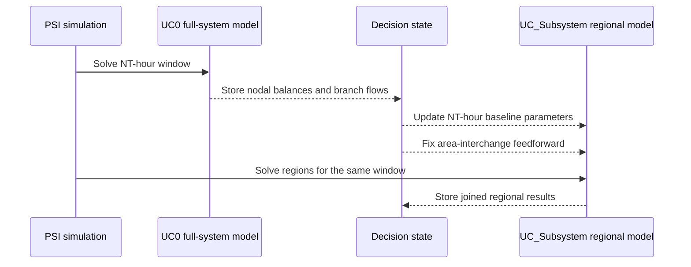
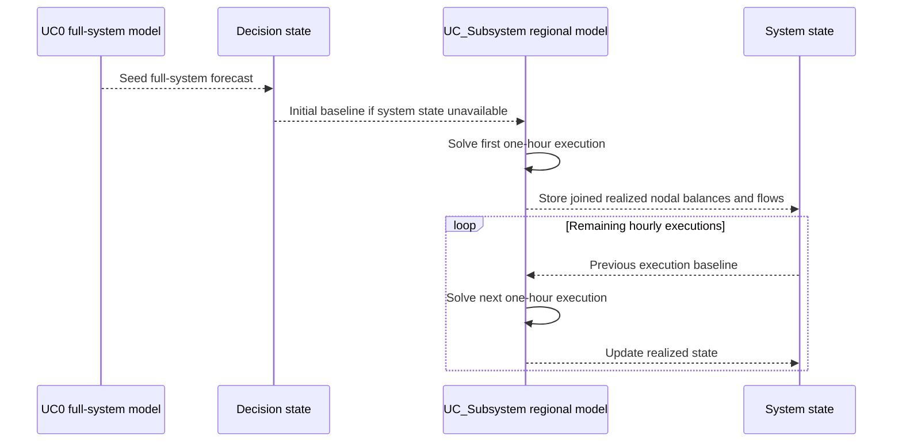
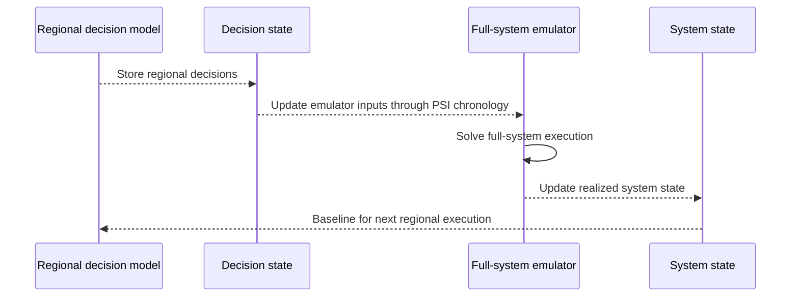

# Horizontal and vertical state passing

These names describe the tested **source and chronology of state**, not two
different regional solve algorithms. Both use sequential regional execution.
The integration fixture is `test/test_utils/simulation_runs.jl`; its helper
`run_rts_multi_stage_decomposition_simulation` is not exported package API.

## Tested stage configuration

The fixture uses `modified_RTS_GMLC_DA_sys`, explicit subsystem/component
assignments, selected monitored branches, `AreaInterchange` components, thermal
unit commitment, and `InterProblemChronology()`.

| Stage                      | Role                                            | Horizon             | Interval            | Resolution |
|:-------------------------- |:----------------------------------------------- |:------------------- |:------------------- |:---------- |
| `UC0`                      | Full-system producer using `AreaPTDFPowerModel` | `NT` hours          | `NT` hours          | 1 hour     |
| `UC_Subsystem`, vertical   | Regional consumer                               | `NT` hours          | `NT` hours          | 1 hour     |
| `UC_Subsystem`, horizontal | Repeated regional consumer/producer             | 1 hour              | 1 hour              | 1 hour     |
| `EM`, optional             | Full-system emulation model                     | Emulation execution | Emulation execution | 1 hour     |

Tests use `NT=5` and one simulation step starting at `2020-01-01T00:00:00`.
Thus one simulation step is not necessarily one hourly regional solve.
The producer covers the consumer's forecast; interval ratios determine the
number of executions. Compatible PSI chronology requires horizons at least as
long as intervals, downstream horizons no longer than the upstream lookahead,
and divisible adjacent intervals.

## Parameter sources

| Consumer parameter                                                      | Source key                                         | Axes                     |
|:----------------------------------------------------------------------- |:-------------------------------------------------- |:------------------------ |
| `PowerSimulationsDecomposition.StateEstimationInjections` on `ACBus`    | `ExpressionKey{ActivePowerBalance, ACBus}("")`     | Bus-number strings, time |
| `PowerSimulationsDecomposition.StateEstimationFlows` on `MonitoredLine` | `ExpressionKey{PTDFBranchFlow, MonitoredLine}("")` | Branch names, time       |

The parameter types are qualified internals. They initialize to zero with unit
multipliers. Simulation updates first inspect system state. If the first state
value is non-finite, or the consumer has more time columns than system state, the
implementation warns and reads decision state instead. Every copied value must
be finite, otherwise it raises an error. Copying is by component name and time
index; it is **not a general resampling or time-aggregation algorithm**.
There is an explicit differing-resolution TODO.

## Vertical: same-window producer to consumer



Solid arrows are calls, dashed arrows are data transfers. With no emulator,
the multi-hour consumer falls back to decision-state values when the one-row
system state cannot cover the horizon. The test verifies producer nodal balances
equal consumer state-estimation injections at **the same timestamps**.

The fixture attaches this PSI feedforward to the regional consumer:

```julia
ff = FixValueFeedforward(;
    component_type=AreaInterchange,
    source=FlowActivePowerVariable,
    affected_values=[FlowActivePowerVariable],
)
sequence = SimulationSequence(;
    models=models,
    feedforwards=Dict("UC_Subsystem" => [ff]),
    ini_cond_chronology=InterProblemChronology(),
)
```

Here `models` must already contain the configured producer and consumer in that
order. This fixes interchange decisions; it does not fix thermal dispatch.
The tested helper does not attach a thermal commitment feedforward. Do not infer
a UC-to-ED commitment mapping from the stage names.

## Horizontal: previous execution to next execution



Without an emulator, the test verifies for each bus that
`StateEstimationInjections(t) ≈ ActivePowerBalance(t-1)` in regional results,
starting with the second execution. The first execution is seeded from the
full-system stage rather than a nonexistent prior regional decision.
No area-interchange fixing feedforward is attached by the horizontal helper.

## Optional emulator



The fixture's `EM` is a PSI **EmulationModel**, not an extra DecisionModel.
With an emulator, it supplies realized system state. The horizontal branch
comparison tests find the standard and state-estimation monitored-line
formulations agree for the tested branch with the emulator, but differ after
the first execution without it. Vertical branch comparisons agree for that
fixture without an emulator.

These are fixture-specific regression assertions, not proofs of general
equivalence, convergence, or physical accuracy. Units and branch signs are
preserved from the producer's system-base expressions. Before adapting the
chronology, verify names, service metadata, source/consumer entries, horizon
coverage, initial conditions, and timestamps.

## Feedforward attachment versus parameter updating

Device feedforwards are attached to matching device models in **each**
regional template; missing device models raise `ConflictingInputsError`.
Service feedforwards are handled separately: supplied metadata selects a named
service, while absent metadata attaches to service models of the matching type.
Do not drop service metadata or treat services as device models.

At execution, the package updates parameters in each regional container, then
resynchronizes objective functions as needed. PSI owns the simulation sequence,
decision/system state stores, initial-condition chronology, and result storage.
The package's own `handle_initial_conditions!` hook is empty, so do not assume
it performs PSI's usual standalone initialization solve.
