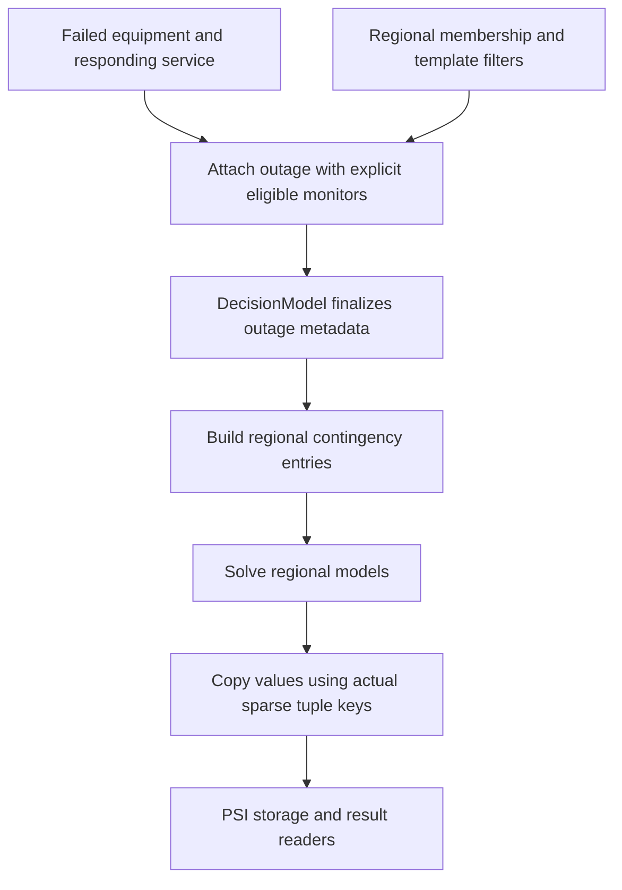

# Security-constrained integration

PowerSystems owns outage attributes and monitored-component identities;
PowerSimulations owns security-constrained reserve and branch formulations.
This package finalizes metadata for regional templates and joins their solved
results. It does not introduce a new security-constrained formulation.
Use [the how-to](../how_to/security_constrained_reserves.md) for executable setup.

## Selection contracts

Outage selection and monitoring selection are separate: failed equipment is
identified by outage attachments, while `monitored_components` requests the
devices whose post-contingency behavior is modeled. Selecting every monitor for
one outage does not enumerate every possible contingency or prove N-1 security.

| Consumer | Outage selection | Boundary in resolved PSI |
|:-------- |:--------------- |:------------------------ |
| Security-constrained reserve service | Outages attached to the named service with a matching SC `ServiceModel` | Upward reserves only; monitor eligibility depends on network formulation |
| Upstream SC branch device model | Outages attached to equipment types covered by an SC device model; explicit selection can restrict discovery | Eligible modeled AC transmission monitors need not themselves use SC device formulations |

The runnable example and active deliverability tests cover generator outages
with `SecurityConstrainedRampReserve`. The branch-device row describes the
upstream contract, not a tested regional line-outage recipe or a blanket
compatibility claim for every formulation.

PowerSystems permits empty monitoring without assigning its downstream meaning.
Resolved PSI warns and skips outages with empty sets. Missing monitored UUIDs
or unsupported/unmodeled monitored types can be warned about and skipped;
other scope mismatches can fail at construction. Check actual result coverage,
not only successful construction.

## Network scope and limits

For PTDF models, select available AC branches actually represented by the
consuming regional template and its filters. External buses in regional PTDF
context do not make all external branches eligible monitors. Ownership does not
reverse the branch flow sign.

`AreaInterchange` is not an AC transmission branch. In the inspected upstream
reserve-service `AreaBalancePowerModel` path, a monitored tie must be available,
in network scope, and included in the template's `AreaInterchange` device model.
Under PTDF, PSI warns and drops these monitors because it does not construct
their post-contingency tie-flow expressions. This upstream distinction does not
extend interchange monitoring to the split-PTDF example.

Requesting a monitored flow is not proof that its physical rating is enforced.
Check the applicable upstream contingency constraints, limits, and branch/network
formulations. Neither `StaticBranchUnbounded` nor this package's
[`StaticBranchUnboundedStateEstimation`](@ref) should be presented as ordinary
thermal-rating enforcement. Flow comparisons and reserve conservation do not
constitute an all-branch security theorem.

## Planned outages

The example uses `GeometricDistributionForcedOutage`. Resolved PSI skips planned
outages attached to SC reserve services unless that service model opts into
`"include_planned_outages"`. SC branch models also skip planned outages during
automatic discovery unless enabled, but explicitly listed outage UUIDs bypass
that discovery filter. Do not transfer one consumer's selection rules to another.

## Regional lifecycle

Configure membership, branch filters, service associations, and monitors before
constructing the `DecisionModel`:

Regional `finalize_template!` delegates metadata to PSI after preparing model and
service associations. Joining preserves actual sparse
`(outage UUID, branch name, time index)` entries, not every Cartesian combination.
It adds no regional result axis and does not resolve overlapping ownership.
Recreate the model after changing monitoring; mutating the System does not
rebuild finalized metadata or existing constraints.

## Evidence and upstream ownership

  - `test_component_assignment.jl`: regional outage metadata and deployment construction.
  - `test_reserve_deliverability.jl`: reference/split 10-bus coverage and RTS export fidelity/conservation.
  - [PSI v0.38.4 source](https://github.com/NLR-Sienna/PowerSimulations.jl/tree/v0.38.4/src): formulation construction and selection rules.
  - [PSY v5.12.3 outage interface](https://github.com/NLR-Sienna/PowerSystems.jl/blob/v5.12.3/src/outages.jl): constructors, monitoring setters, and UUID storage.

Check behavior against resolved dependency versions. See
[support boundaries](../api/support.md) and
[contingency results](../how_to/results.md#Contingency-flow-results).