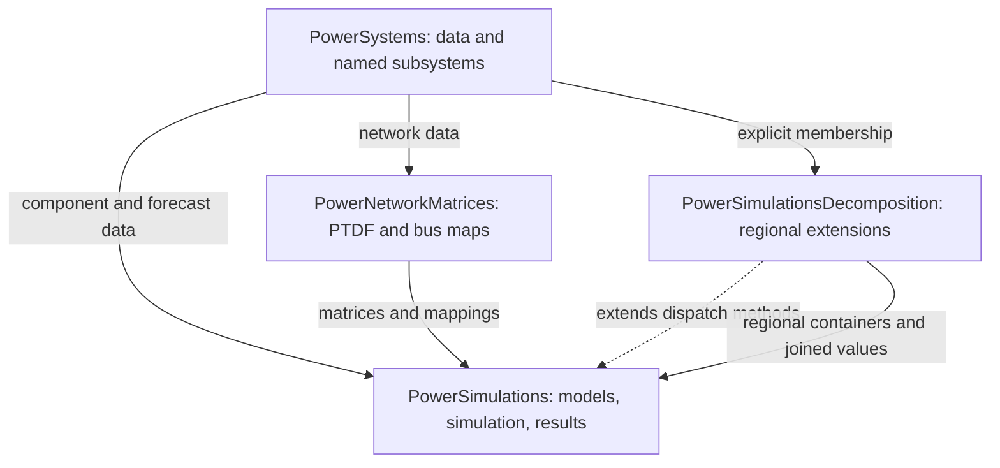

# PowerSimulationsDecomposition.jl

PowerSimulationsDecomposition extends PowerSimulations with subsystem-filtered
regional optimization containers, split-area PTDF modeling, state-estimation
parameters, and sequential result aggregation. It is intended for researchers
who already understand PowerSystems data and PowerSimulations templates.

## Choose a path

| Need                                      | Start here                                              |
|:----------------------------------------- |:------------------------------------------------------- |
| Install compatible dependencies           | [Getting started](quick_start_guide.md)                 |
| Build and solve a small example           | [Two-region dispatch tutorial](tutorials/intro_page.md) |
| Control component membership              | [Assign subsystems](how_to/subsystems.md)               |
| Inspect outputs                           | [Read results](how_to/results.md)                       |
| Understand the decomposition              | [Split-area modeling](explanation/decomposition.md)     |
| Understand time and state transfers       | [State passing](explanation/state_passing.md)           |
| Look up equations and parameter contracts | [Formulation library](formulation_library/network.md)   |
| Find exported bindings                    | [Public API](api/public.md)                             |
| Extend or maintain the package            | [Developer guide](developer/index.md)                   |

The structure follows PowerSimulations' separation of tutorials, how-to guides,
explanations, and reference material, but covers only this package's implemented
extensions. The [support reference](api/support.md) identifies evidence and limits:
in particular, MPI (Message Passing Interface) execution is incomplete and
reserve-deliverability tests are disabled. MPI is a standard for communication
between processes in parallel programs, not a convergence algorithm.
There is no automatic partitioning, convergence guarantee, or global-optimality
equivalence claim.

## Package relationships

Solid arrows denote data supplied to a consumer; the dashed arrow denotes Julia
method extensions, not ownership of PowerSimulations. PowerSystems owns component
data; this package does not split it into independently copied Systems.
See the [extension lifecycle](developer/architecture.md) for construction calls.

## Project and institution

Source and issue tracking are at
[NLR-Sienna/PowerSimulationsDecomposition.jl](https://github.com/NLR-Sienna/PowerSimulationsDecomposition.jl).
The default branch is `main`. No published stable/dev manual was available when
these documentation destinations were checked; a successful local build is not a
deployment.

The current laboratory name is
[National Laboratory of the Rockies (NLR)](https://www.nlr.gov/).
Historical attribution and the BSD license are preserved in the repository.
